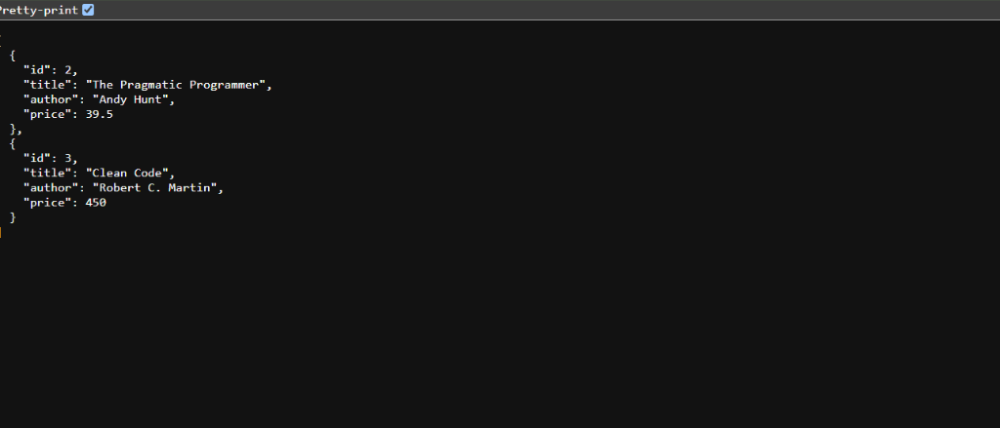
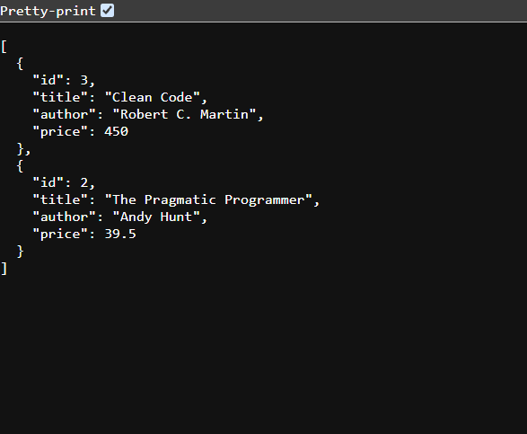
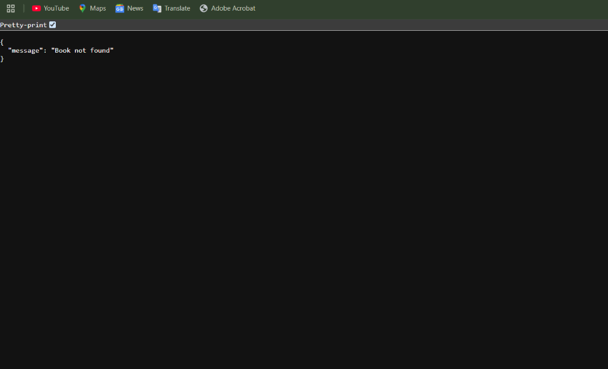

# Lab 3: REST API, Query Parameters, Validation, and Debugging

A robust, production-grade Express.js and SQLite backend implementing plural noun routing, query parameter filtering/sorting/pagination, defense-in-depth SQL injection prevention, pre-database payload validation, and uniform error formatting.

---
NAME: S.KARTHIKEYA REDDY
ROLL:252U1R8089
 render deployed link:https://backend-lab-3-2o21.onrender.com
## 1. Project Setup & Run Instructions

### Prerequisites
- Node.js >= 18.0.0
- npm >= 9.0.0

### Installation
Clone or navigate to the project directory and install dependencies:
```bash
npm install
```

### Free Port 3000 (Windows Utility)
If port 3000 is occupied by a background process (`EADDRINUSE`), run the included utility script:
```bash
npm run kill:port
```

### Running the Server
- **Production mode:**
  ```bash
  npm start
  ```
- **Development mode (auto-reload with Node --watch):**
  ```bash
  npm run dev
  ```
The server will initialize the SQLite database (`database.db`) and listen on `http://localhost:3000` (or the port specified by `process.env.PORT`).

### Automated Test Suite
Run the comprehensive 17-point automated integration test suite:
```bash
npm test
```

### Postman Collection
Import `Lab3_Postman_Collection.json` directly into Postman (**Import** &rarr; **Raw text** or **File**) to execute automated test assertions against all endpoints.

---

## 2. API Specifications

### Endpoints
| Method | Endpoint | Description | Status Codes |
|---|---|---|---|
| `GET` | `/books` | List books with search, sort, filter, and pagination | `200`, `400`, `500` |
| `GET` | `/books/:id` | Retrieve single book by primary key ID | `200`, `404`, `500` |
| `POST` | `/books` | Create a new book record | `201`, `400`, `500` |
| `PUT` | `/books/:id` | Update an existing book record | `200`, `400`, `404`, `500` |
| `DELETE`| `/books/:id` | Delete a book record by ID | `200`, `404`, `500` |

### Query Parameters for `GET /books`
- `search_q` (string, default `""`): Partial title match using SQL `LIKE ?`.
- `order_by` (string, default `"id"`): Whitelisted column (`id`, `title`, `author`, `price`).
- `order` (string, default `"ASC"`): Whitelisted sort direction (`ASC`, `DESC`).
- `limit` (integer, default `10`): Number of records to return (must be positive integer).
- `offset` (integer, default `0`): Number of records to skip (must be non-negative integer).
- `min_price` & `max_price` (numbers): Filter price range (`min_price <= max_price`).

---

## 3. Task 7: Debugging Report

### Issue 1: Port Conflict (`EADDRINUSE`)
- **Cause:** A previous Node.js process was terminated abnormally or left running in the background, keeping the TCP socket bound to port 3000.
- **Solution:** Identify the process PID holding port 3000 using PowerShell (`Get-NetTCPConnection -LocalPort 3000`) or `netstat -ano | findstr :3000`, and kill it via `Stop-Process -Id <PID> -Force` (or `taskkill /PID <PID> /F`). Added an npm script `"kill:port"` in `package.json` to automate this workflow.

### Issue 2: Wrong Import Path (`MODULE_NOT_FOUND`)
- **Cause:** Incorrect relative directory traversal (e.g., `require('../../database')` instead of `require('./database')`) or casing discrepancies on case-sensitive deployment filesystems (e.g. Linux on Render vs. Windows local).
- **Solution:** Standardize module imports relative to the project root (`./database`), resolve file paths using Node's `path.join(__dirname, ...)`, and ensure exact case matching between filenames on disk and require statements.

### Issue 3: Table-Name Typo (`no such table: ...`)
- **Cause:** SQL statements referencing mismatched table identifiers (e.g., `SELECT * FROM book` instead of `books`), or route handlers receiving requests before asynchronous database schema initialization has completed.
- **Solution:** Standardize table naming conventions across all queries (`books`), and enforce synchronous boot sequencing by awaiting `initializeDB()` before mounting `app.listen()`.

### Issue 4: Missing `await` in Asynchronous Database Calls
- **Cause:** Invoking asynchronous database driver methods (`db.all()`, `db.run()`, `db.get()`) without the `await` keyword. Because JavaScript returns an unresolved `Promise` immediately, synchronous evaluation treats the Promise as truthy, returning empty/unresolved objects or triggering race conditions and unhandled rejections.
- **Solution:** Ensure all route handlers are declared `async (req, res, next) => { ... }` and strictly prepend `await` before every database call.

---

## 4. Viva Voce Questions & Answers

### Question 1: Query Parameters vs. Path Parameters
- **Path Parameters (`/books/:id`):**
  - **Purpose:** Identifies a **specific resource** hierarchically within the API endpoint tree.
  - **Usage:** Mandatory for pointing directly to a unique entity (e.g., primary key ID `1`).
  - **Rule of Thumb:** If removing the parameter changes *which* distinct entity you are operating on, use a Path Parameter.
- **Query Parameters (`/books?order_by=price&limit=5`):**
  - **Purpose:** Modifies, filters, sorts, or paginates the **representation** of a resource collection.
  - **Usage:** Optional modifiers that alter the query criteria without altering the identity of the underlying resource collection.
  - **Rule of Thumb:** If the parameter is optional or alters how results are shaped, filtered, or sorted, use Query Parameters.

### Question 2: Statelessness in REST Architecture
- **Definition:** Every client request to the server must contain **all** the context and information required to authenticate, understand, and fulfill that request. The server does not store client session state between requests.
- **Benefits:**
  1. **Horizontal Scalability:** Any application server node in a load-balanced cluster can handle any request without needing shared memory or sticky sessions.
  2. **Fault Tolerance & Reliability:** If a server node crashes, subsequent client requests can immediately be fulfilled by another node without lost session data.
  3. **Simpler Caching & Monitoring:** Independent requests allow HTTP proxies and caches to safely cache idempotently without cross-request state dependencies.

### Question 3: HTTP 400 Bad Request vs. HTTP 404 Not Found
- **HTTP 400 Bad Request:**
  - **Meaning:** The server cannot or will not process the request due to an apparent client error (e.g., malformed JSON syntax, invalid query parameters such as negative limit/offset, inverted price ranges, or missing required body fields).
  - **Context:** The resource endpoint exists, but the request payload or parameter format violates validation rules.
- **HTTP 404 Not Found:**
  - **Meaning:** The server cannot find the requested resource or URI route.
  - **Context:** Triggered when the client navigates to an undefined route (e.g., `GET /authors`) or requests an entity ID that does not exist in the database (e.g., `GET /books/999999`).

---

## 5. Deployment on Render

1. Connect your repository to Render (**New +** &rarr; **Web Service**).
2. Configure settings:
   - **Environment:** `Node`
   - **Build Command:** `npm install`
   - **Start Command:** `npm start`
3. Render automatically sets `process.env.PORT`. The application binds dynamically to `process.env.PORT || 3000`.

---

## 6. Output Screenshots

### 1. Default Books Listing (`GET /books`)


### 2. Sorted Books Listing (`GET /books?order_by=price&order=DESC`)


### 3. Resource Not Found Error (`GET /books/:id` - 404)



